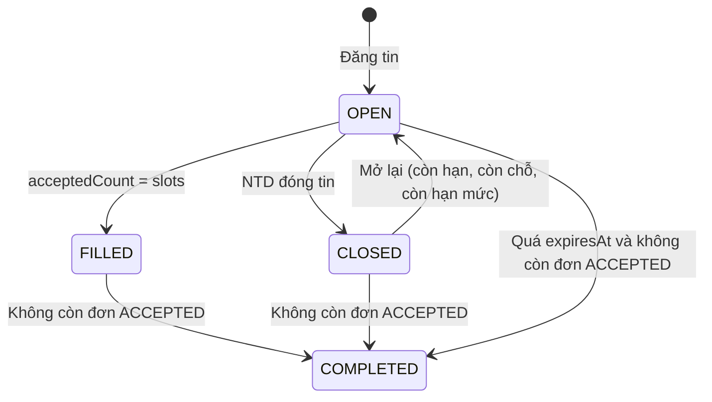
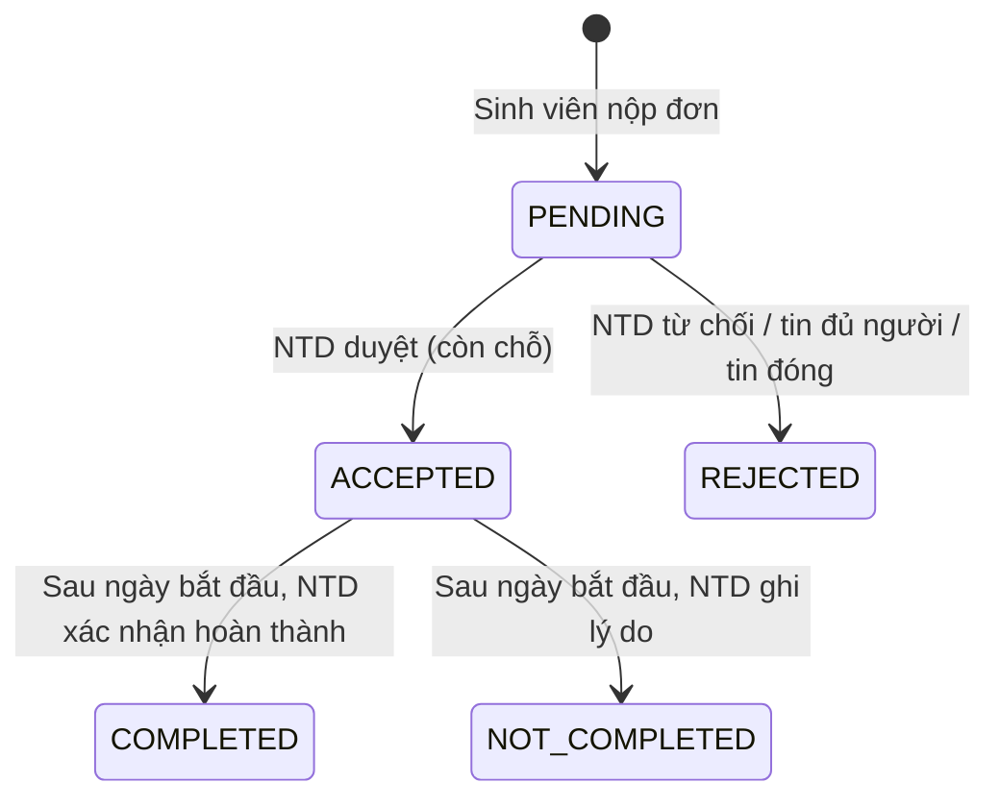

# Vòng đời trạng thái

## Tin tuyển dụng (Job)

- Tin chỉ hiển thị công khai khi `status = OPEN`, chưa quá `expiresAt`, chưa bị xóa mềm và nhà tuyển dụng không bị khóa.
- Khi tin chuyển sang `FILLED` hoặc `CLOSED`, mọi đơn `PENDING` còn lại tự động bị từ chối kèm lý do.
- Tin đã có đơn ứng tuyển thì không xóa được, chỉ đóng được.
- Tin đã nhận người thì khóa các trường lương, địa điểm, ngày bắt đầu; `slots` không được nhỏ hơn `acceptedCount`.
- `HIDDEN` dành cho quản trị viên ẩn tin vi phạm; tin bị ẩn không sửa được.

### Hạn mức đăng tin

| Gói | Số tin OPEN cùng lúc | Số ngày hiển thị |
| --- | --- | --- |
| Miễn phí | 3 | 14 |
| Premium | 20 | 30 |

Tin của tài khoản Premium được gắn `featuredUntil` và xếp lên đầu danh sách.

## Đơn ứng tuyển (Application)

- Sinh viên phải xác thực email và có CV trong hồ sơ mới được nộp đơn; mỗi tin chỉ nộp 1 lần.
- Thông tin liên hệ (email, SĐT) của hai bên chỉ hiện khi đơn đã `ACCEPTED` trở về sau.
- Mỗi lần đổi trạng thái được ghi vào `statusHistory` và gửi thông báo cho bên liên quan.
